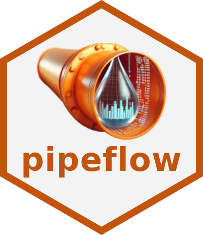
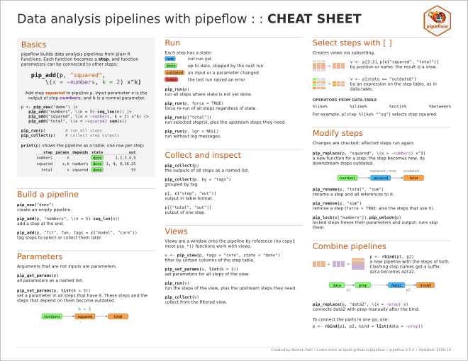
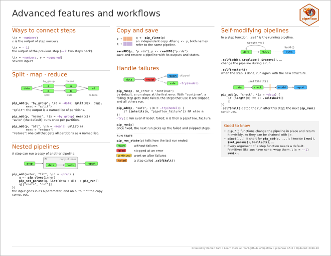

<!-- README.md is generated from README.Rmd. Please edit that file -->

```{r, include = FALSE}
require(badger)
knitr::opts_chunk$set(
    collapse = TRUE,
    comment = "#",
    prompt = F,
    fig.path = "images/README-",
    tidy = FALSE,
    cache = FALSE,
    out.width = "100%"
)

old <- options(width = 100L)
```

<!-- badges: start -->

[](https://cran.r-project.org/package=pipeflow)
[](https://CRAN.R-project.org/package=pipeflow)
[](https://app.codecov.io/gh/rpahl/pipeflow)
[](https://github.com/rpahl/pipeflow/actions)
[](https://github.com/rpahl/pipeflow/actions)
[](https://github.com/rpahl/pipeflow/actions/workflows/ci.yaml)
<!-- [](https://cran.r-project.org/web/checks/check_results_pipeflow.html) -->
[](https://cran.r-project.org/package=pipeflow)
[](https://cran.r-project.org/package=pipeflow)
[](https://github.com/rpahl/pipeflow/commits/main)
[](https://lifecycle.r-lib.org/articles/stages.html#experimental)

<!-- badges: end -->

# pipeflow 

{pipeflow} is a lightweight framework for building interactive data
analysis pipelines in R. You add R functions one by one as steps, tell
{pipeflow} which steps they take their inputs from, and it keeps the
pipeline consistent as you insert, replace or remove steps.


### Why pipeflow?

* concise API: steps are plain R functions
* all parameters in one place
* checked as you build
* reruns only what changed
* fast: data.table and C++ DAG under the hood
* feature rich: views, split/map/reduce, nested pipelines

### Installation

```{r, eval = FALSE}
# Install release version from CRAN
install.packages("pipeflow")

# Install development version from GitHub
devtools::install_github("rpahl/pipeflow")
```


### Cheat sheet

<a href="https://github.com/rpahl/pipeflow/blob/main/cheatsheet/pipeflow-cheatsheet.pdf"> </a>

### Usage

```{r usage}
library(pipeflow)

p <- pip_new("demo") |>
    pip_add("numbers", \(n = 5) seq_len(n)) |>
    pip_add("squared", \(x = ~numbers) x^2) |>
    pip_add("total", \(x = ~squared) sum(x))

p

pip_run(p)

pip_collect(p)
```

### Getting Started

It is recommended to read the vignettes in the order they are listed below:

* [Get started with pipeflow](https://rpahl.github.io/pipeflow/articles/v01-get-started.html)
* [Modify existing pipelines](https://rpahl.github.io/pipeflow/articles/v02-modify-pipeline.html)
* [Combine pipelines](https://rpahl.github.io/pipeflow/articles/v03a-combine-pipelines.html)
* [Pipeline views](https://rpahl.github.io/pipeflow/articles/v03b-pipeline-views.html)
* [Collect and group output](https://rpahl.github.io/pipeflow/articles/v04-collect-output.html)


### Advanced workflows

* [Split, map, and reduce](https://rpahl.github.io/pipeflow/articles/v05a-split-map-reduce.html)
* [Nested pipelines](https://rpahl.github.io/pipeflow/articles/v05b-nested-pipeline.html)
* [Handling failures](https://rpahl.github.io/pipeflow/articles/v05c-error-handling.html)
* [Annotated parameter values](https://rpahl.github.io/pipeflow/articles/v05d-param-value.html)
* [Annotated step outputs](https://rpahl.github.io/pipeflow/articles/v05e-output-value.html)
* [Self-modifying pipelines](https://rpahl.github.io/pipeflow/articles/v06-self-modify-pipeline.html)

### pipeflow vs targets

* [Comparison and benchmarks](https://rpahl.github.io/pipeflow/articles/v07-vs-targets.html)
* [Emulating targets features](https://rpahl.github.io/pipeflow/articles/v07b-emulate-targets.html)

```{r, include = FALSE}
options(old)
```