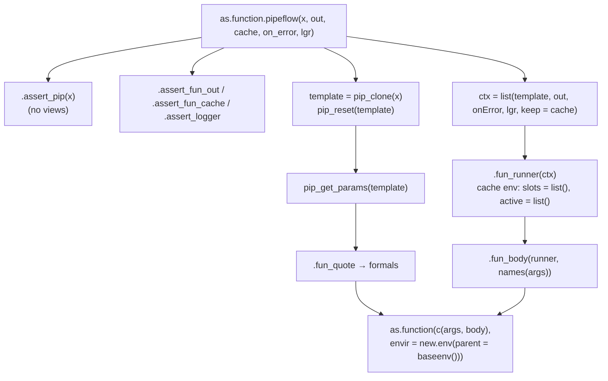
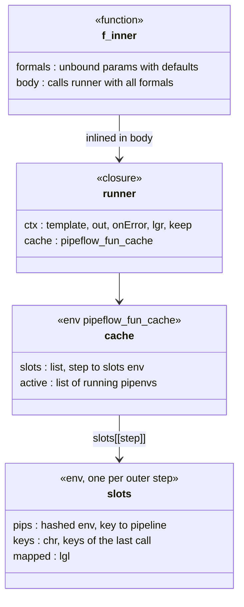
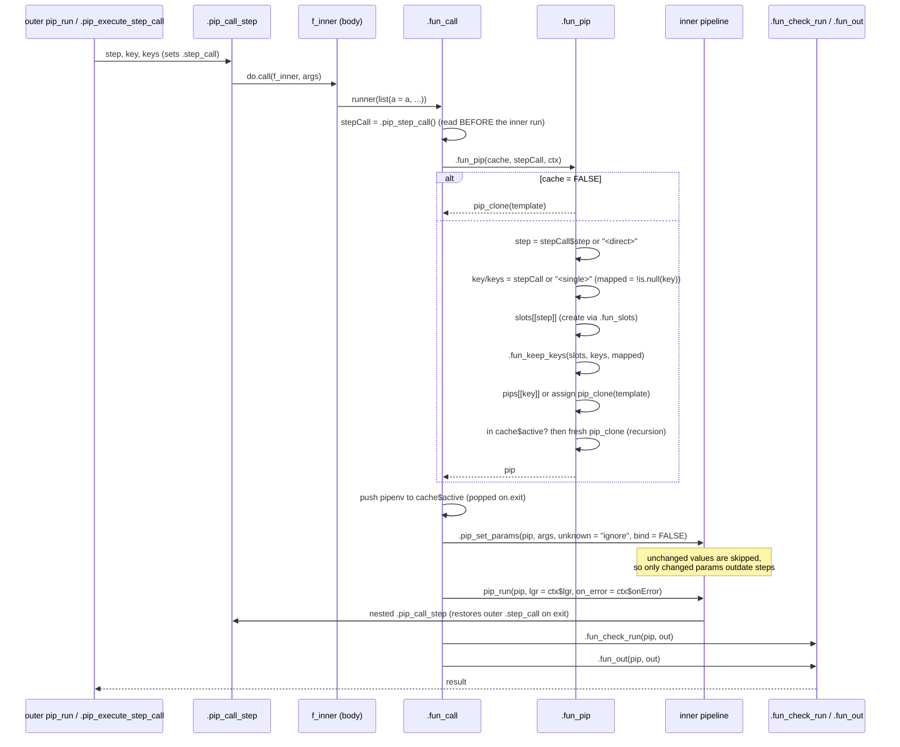
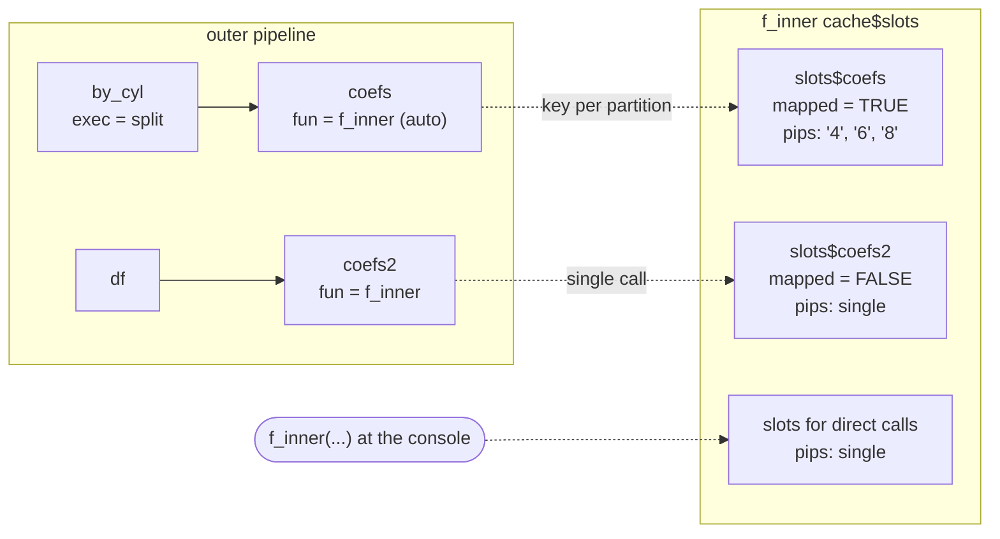
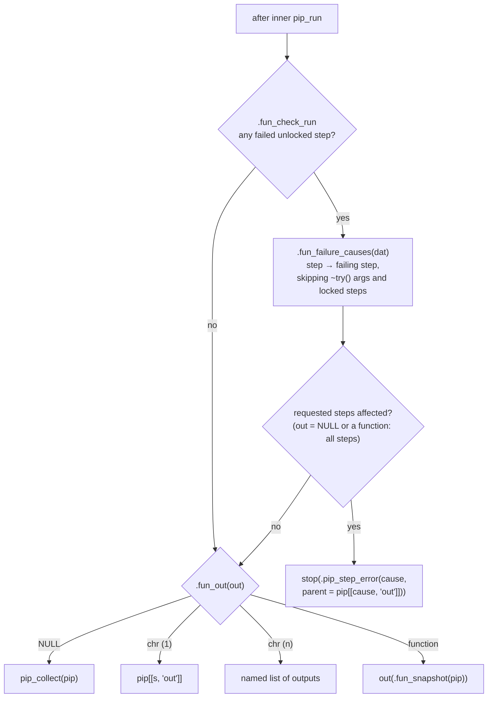
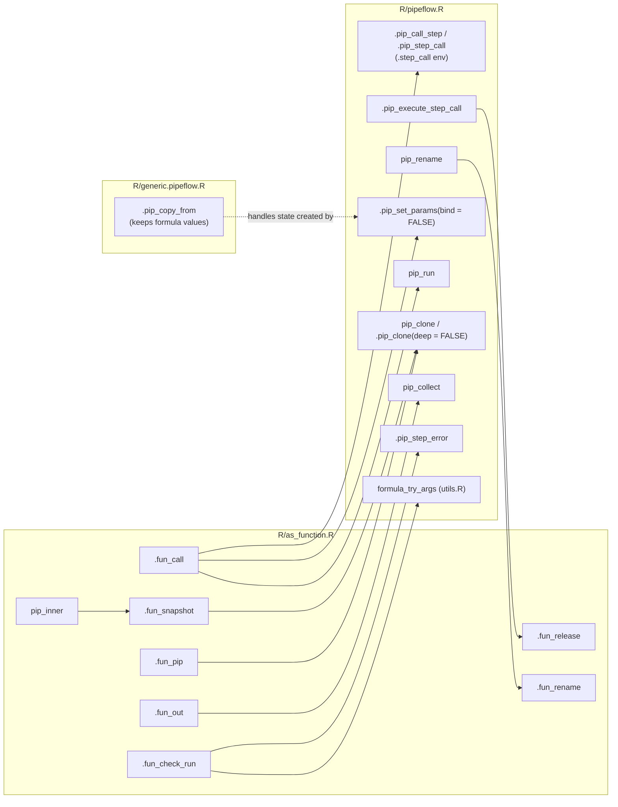

# Pipelines as functions (`R/as_function.R`)

`as.function(p)` turns a pipeline into an ordinary R function. You can call
that function directly, or add it as a step to an "outer" pipeline with
`pip_add()`. The function keeps the inner pipelines it has run, one per
outer step and partition key, so a later call only runs the inner steps
that changed params or inputs have outdated. `pip_inner()` lets you look at
these kept pipelines.

This file builds on [pipeflow.md](pipeflow.md). Read that first for the
data model, `.step_call` and the run loop.

## 1. Function map

| Function | Role |
|---|---|
| `as.function.pipeflow(x, out, cache, on_error, lgr)` | Entry point. Validates the arguments, takes a reset snapshot (`template`), builds the formals from `pip_get_params()`, and assembles the function. |
| `.assert_fun_out()`, `.assert_fun_cache()` | Validate `out` (NULL, step names, or a function with ≥ 1 argument) and `cache`. |
| `.fun_quote(args)` | Wraps symbol and call defaults in `quote()`, so they are not evaluated a second time. |
| `.fun_body(runner, formalNames)` | Builds the body `runner(list(a = a, ...))`. The runner and `base::list` are inlined as objects, so a formal named `list` cannot shadow them. |
| `.fun_runner(ctx)` | Makes the closure that holds `ctx` and the `cache` env (class `pipeflow_fun_cache`, with `slots` and `active`). |
| `.fun_call(args, ctx, cache)` | One call: find the pipeline, set the params, run it, check the result, extract the output. |
| `.fun_pip(cache, stepCall, ctx)` | Picks (or makes) the slot pipeline for the current `step` and `key`. |
| `.fun_slots()` | New slot set of a step: `pips` (hashed env key → pipeline), `keys`, `mapped`. |
| `.fun_keep_keys(slots, keys, mapped)` | Drops the pipelines whose keys are gone. Runs once per outer step run, because the `keys` object is `identical()` for all partitions of that run. |
| `.fun_slot_pips(slots)` | The kept pipelines in key order. |
| `.fun_cache(fun)` | Recovers the cache env from a function made by `as.function()`, or returns `NULL`. |
| `.fun_release(fun, step)` | Drops a step's slots when it is mapped over zero keys. |
| `.fun_rename(fun, from, to)` | Moves a step's slots when the outer step is renamed. |
| `.fun_check_run(pip, out)` | With `on_error = "continue"`: raises the error if a requested step failed or was blocked. |
| `.fun_failure_causes(dat)` | Follows failures along the run (honouring `~try()` and `locked`) and returns step → failing step. |
| `.fun_out(pip, out)` | Builds the result: `pip_collect()`, one or more step outputs, or `out(snapshot)`. |
| `.fun_snapshot(pip)` | A light copy (`.pip_clone(deep = FALSE)`) that keeps the run state and last-run time. |
| `.fun_pips(fun)` | All kept pipelines of a function. Only the tests use it. |
| `pip_inner(x, step)` | Exported. Snapshots of the kept pipelines of an outer step. |

## 2. Construction

The function this produces looks like this:

The cache belongs to the function and not to a global registry. Dropping
the function drops its pipelines. Serialising the function copies them,
which is cheap when the function was made with `cache = FALSE` or has not
been called yet.

## 3. One call

Details that are easy to break:

- **`bind = FALSE`.** The function's arguments are values. A formula
  argument is stored as a value and does not become a reference
  (`.pip_set_params(bind = FALSE)`). This is the only caller with
  `bind = FALSE`. Because of it, an inner pipeline can hold an unbound param
  whose value is a formula, and `.pip_copy_from()` has special handling for
  that case.
- **Read `.step_call` first.** `.fun_call()` reads the step call before
  `pip_run()`, because the inner run's own `.pip_call_step()` calls
  overwrite it until they return.
- **Re-entrancy.** `cache$active` holds the `pipenv`s that are currently
  running. A recursive call that would get a slot that is already running
  gets a throwaway clone instead, so it does not change the params of the
  running pipeline.
- **Failure keeps progress.** The slot is stored before the run, so after an
  inner error the steps that already ran are reused on the next call.
- **Placeholder keys.** `.fun_key_single` (`"<single>"`) is used for calls
  that are not mapped, and `.fun_step_direct` (`"<direct>"`) for calls made
  outside a step. If one of them clashes with a real name, calls share a
  pipeline. That is slower but still correct.

## 4. Slots across outer runs

How slots change with the outer pipeline:

| Outer event | Effect on slots | Done by |
|---|---|---|
| Partition keys change | Pipelines of keys that are gone are removed | `.fun_keep_keys()` (first call of the run) |
| Step switches between mapped and single | All pipelines of the other mode are dropped | `.fun_keep_keys()` (`mapped` changed) |
| Mapped over zero keys | No call happens, so the slots are dropped explicitly | `.pip_execute_step_call()` → `.fun_release()` |
| Outer step renamed | `slots[[from]]` moves to `slots[[to]]` | `pip_rename()` → `.fun_rename()` |
| Outer step removed or replaced | The slots stay until the function is garbage-collected | — |
| `pip_run(force = TRUE)` on outer | Inner pipelines are **not** forced | — (use `cache = FALSE`) |

If the same function is used by two outer pipelines with the same step name,
both use the same slot. Results stay correct, but caching does not help.

## 5. Output and errors

- With `on_error = "stop"`, the inner `pip_run()` raises a
  `pipeflow_step_error`. In the outer run it becomes the step's error, and
  for a mapped step it is wrapped once more in a `pipeflow_key_error`.
- `.fun_failure_causes()` must follow failures the same way as the
  `failures` bookkeeping in `pip_run()`. If you change which steps
  `pip_run()` skips or runs with a failure, change both.
- `.fun_snapshot()` and `pip_inner()` return light copies. They have their
  own step table and DAG, but share the output objects, so modifying an
  output in place (e.g. data.table `:=`) also changes the kept pipeline.

## 6. Coupling with the core

If you change any of the core functions above, check `as_function.R` too,
and run `tests/testthat/test_as_function.R`. That file defines its
fixtures inline and not in a `helper_*.R` file. Closures from a helper
would have the attached package environment as an ancestor, and under
`load_all()` they cannot be serialised without a warning.
