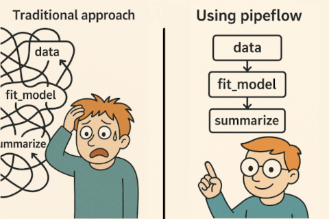

# pipeflow

{pipeflow} is a lightweight framework for building interactive data
analysis pipelines in R. You add R functions one by one as steps, tell
{pipeflow} which steps they take their inputs from, and it keeps the
pipeline consistent as you insert, replace or remove steps.



### Why pipeflow?

- concise API: steps are plain R functions
- all parameters in one place
- checked as you build
- reruns only what changed
- fast: data.table and C++ DAG under the hood
- feature rich: views, split/map/reduce, nested pipelines

### Installation

``` r

# Install release version from CRAN
install.packages("pipeflow")

# Install development version from GitHub
devtools::install_github("rpahl/pipeflow")
```

### Cheat sheet

[](https://github.com/rpahl/pipeflow/blob/main/cheatsheet/pipeflow-cheatsheet.pdf)

### Usage

``` r

library(pipeflow)

p <- pip_new("demo") |>
    pip_add("numbers", \(n = 5) seq_len(n)) |>
    pip_add("squared", \(x = ~numbers) x^2) |>
    pip_add("total", \(x = ~squared) sum(x))

p
# <pipeflow> demo (3 steps)
# -------------------------
#       step params depends state
# 1: numbers      n           new
# 2: squared      x numbers   new
# 3:   total      x squared   new
# -------------------------
# <ready> last run: never

pip_run(p)
# info [2026-10-25 16:44:38.543 UTC]: Starting run of pipeflow 'demo'
# info [2026-10-25 16:44:38.543 UTC]: Step 1/3 numbers
# info [2026-10-25 16:44:38.549 UTC]: Step 2/3 squared
# info [2026-10-25 16:44:38.553 UTC]: Step 3/3 total
# info [2026-10-25 16:44:38.554 UTC]: Finished in 0.012 s (3 done, 0 skipped, 0 failed)

pip_collect(p)
# $numbers
# [1] 1 2 3 4 5
# 
# $squared
# [1]  1  4  9 16 25
# 
# $total
# [1] 55
```

### Getting Started

It is recommended to read the vignettes in the order they are listed
below:

- [Get started with
  pipeflow](https://rpahl.github.io/pipeflow/articles/v01-get-started.html)
- [Modify existing
  pipelines](https://rpahl.github.io/pipeflow/articles/v02-modify-pipeline.html)
- [Combine
  pipelines](https://rpahl.github.io/pipeflow/articles/v03a-combine-pipelines.html)
- [Pipeline
  views](https://rpahl.github.io/pipeflow/articles/v03b-pipeline-views.html)
- [Collect and group
  output](https://rpahl.github.io/pipeflow/articles/v04-collect-output.html)

### Advanced workflows

- [Split, map, and
  reduce](https://rpahl.github.io/pipeflow/articles/v05a-split-map-reduce.html)
- [Nested
  pipelines](https://rpahl.github.io/pipeflow/articles/v05b-nested-pipeline.html)
- [Handling
  failures](https://rpahl.github.io/pipeflow/articles/v05c-error-handling.html)
- [Annotated parameter
  values](https://rpahl.github.io/pipeflow/articles/v05d-param-value.html)
- [Annotated step
  outputs](https://rpahl.github.io/pipeflow/articles/v05e-output-value.html)
- [Self-modifying
  pipelines](https://rpahl.github.io/pipeflow/articles/v06-self-modify-pipeline.html)

### pipeflow vs targets

- [Comparison and
  benchmarks](https://rpahl.github.io/pipeflow/articles/v07-vs-targets.html)
- [Emulating targets
  features](https://rpahl.github.io/pipeflow/articles/v07b-emulate-targets.html)
