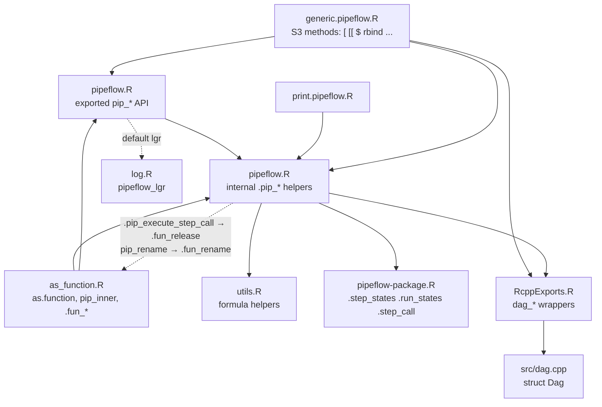
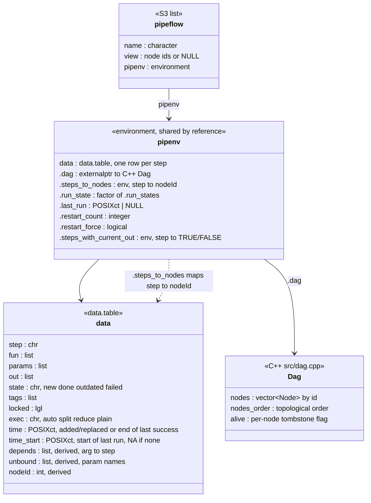
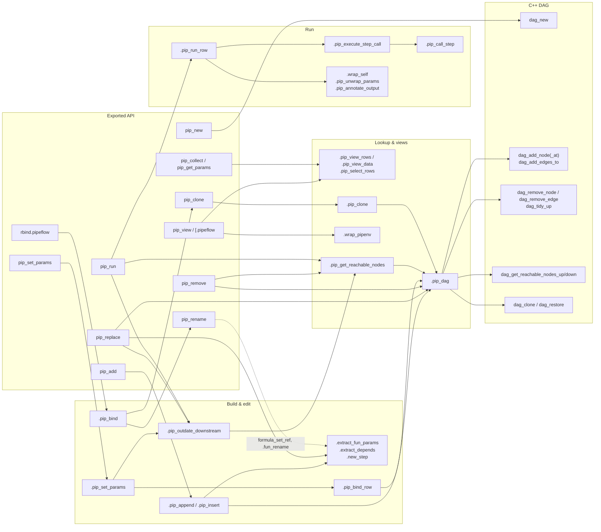
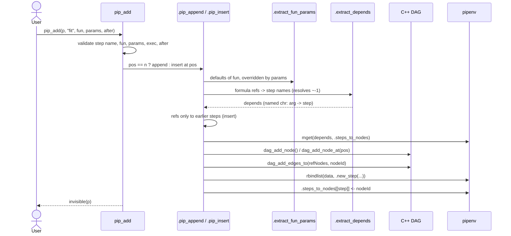
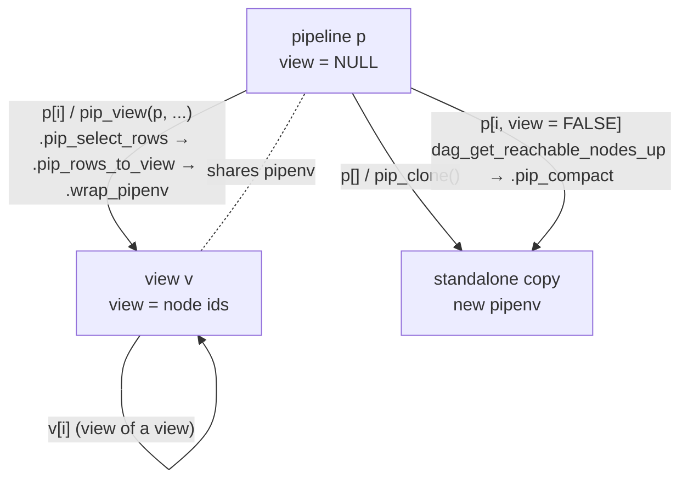
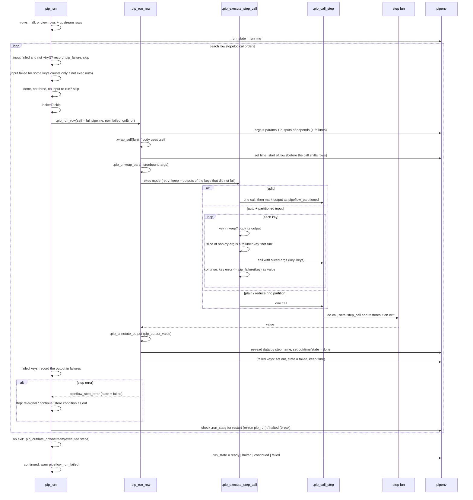
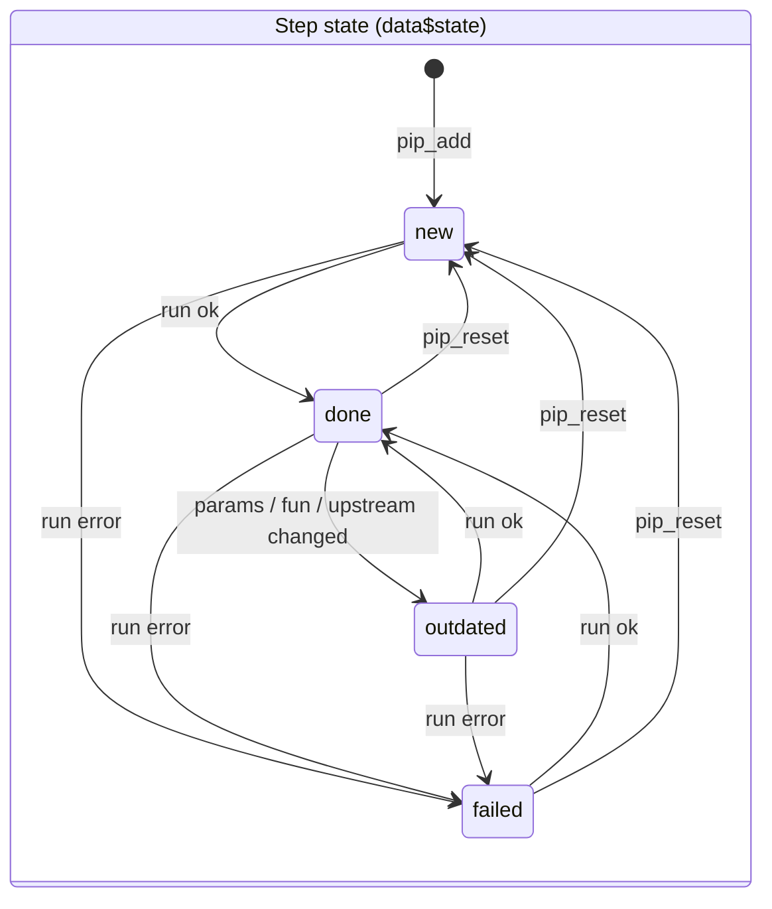
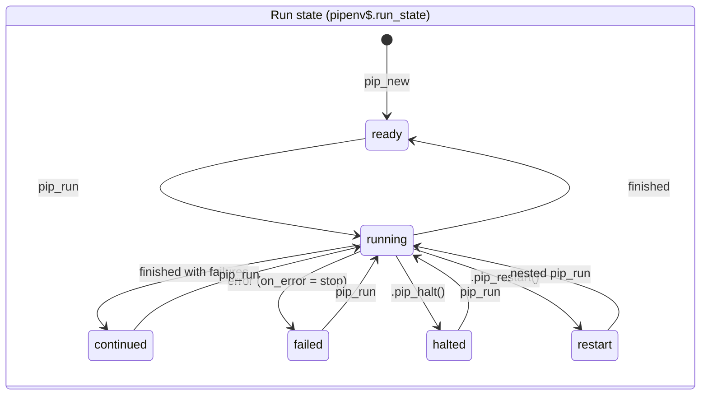

# pipeflow architecture

This file describes how the package is built: the data model, which modules
and functions call each other, and the flows that build, edit and run a
pipeline. It is meant for developers and coding agents. `CLAUDE.md` gives the
short version. For pipelines used as functions (`as.function()`,
`pip_inner()`), see [as_function.md](as_function.md).

Functions are named, not linked by line number, because line numbers go
stale. Use `grep -n "^<name> <-" R/*.R` to find a definition. When you change
a flow that is described here, update this file in the same PR.

## 1. File map

| File | Role |
|---|---|
| `R/pipeflow.R` | Exported `pip_*` API. Internal `.pip_*` helpers sit at the top, grouped by section (construction, asserts, wrappers, param parsing, step execution, state updates, data access, DAG traversal, addition/binding). |
| `R/generic.pipeflow.R` | S3 methods: `[`, `[[`, `$` and their assignment forms, `length`, `dim`, `str`, `rbind`. Helpers `.pip_copy_from()`, `.pip_compact()` and `.pip_subset2()`. Re-exports the data.table operators. |
| `R/as_function.R` | `as.function.pipeflow()`, `pip_inner()` and the `.fun_*` cache helpers. See [as_function.md](as_function.md). |
| `R/print.pipeflow.R` | `print.pipeflow()`, `.format_out()` and `.format_condition()`. |
| `R/utils.R` | Formula helpers (`formula_deps()`, `formula_try_args()`, `formula_set_ref()`, `is_try_ref()`, `is_one_sided_formula()`) and small utilities (`.is_single()`, `stop_no_call()`, `unlist1()`). |
| `R/log.R` | Default logger `pipeflow_lgr(level, msg)`. |
| `R/pipeflow-package.R` | Package-level constants: `.step_states`, `.run_states`, `.step_call` and `.derived_cols`. |
| `R/RcppExports.R`, `src/RcppExports.cpp` | Generated by `Rcpp::compileAttributes()`. Never edit them by hand. |
| `src/dag.cpp` | The C++ DAG behind an external pointer. Exposed as `dag_*()`. |

## 2. Module dependencies

Arrows mean "calls into".

There are two back-edges from the core into `as_function.R`, the dotted
arrow at the bottom. Both keep the cache of a pipeline function in sync when
the outer pipeline changes. They do nothing for ordinary step functions.

## 3. Data model

`.empty_pipeline()` defines the table schema and `.new_step()` builds one
row. `pip_new()` builds `pipenv`. The `pipeflow` object is only a handle. A
view is a second handle on the same `pipenv` whose `view` field is set
(`.wrap_pipenv()`).

### Invariants

Most bugs break one of these. Check them after every change that touches
structure:

1. **Row order is a topological order.** A step may only refer to steps in
   earlier rows. `.pip_insert()`, `pip_replace()`,
   `.pip_check_bind_order()` and `.pip_bind()` enforce this. `pip_run()`
   relies on it: it simply loops over the rows.
2. **The `nodeId` column, `.steps_to_nodes` and the DAG agree.** Every
   function that adds, removes or renames a step updates all three.
   `.pip_dag_restore()` checks the first two and fails if they disagree.
3. **Node ids are never reused.** Views store node ids, not row numbers, so
   a view keeps covering its steps when rows move (`.pip_rows_to_view()`,
   `.pip_view_rows()`). Only `.pip_compact()` makes new, compact ids, and it
   does so for a new pipeline.
4. **`depends`, `unbound` and `nodeId` are derived.** They are recomputed
   from `fun` and `params` (`.extract_fun_params()`,
   `.extract_depends()`, `.new_step()`, `.pip_bind_row()`). `[[<-` rejects
   direct writes to them (`.derived_cols`).
5. **Reference formulas in `params` mirror `depends`.** Rename, `rbind` and
   `[<-` copying rebuild the formulas with `formula_set_ref()`, which keeps
   a `try()` wrapper. Run-time lookup uses only `depends`.
6. **Mutate in place, return `x` invisibly.** Edits use
   `data.table::set()` or `env[["data"]] <- ...` on the shared `pipenv`.
   Real copies only come from `pip_clone()` / `.pip_clone()`, `p[]` on a
   pipeline and `p[i, view = FALSE]`. On a view, `v[]` returns a view of the
   same pipeline.
7. **`.step_call` is restored on exit.** `.pip_call_step()` sets the
   running step (and its partition key) and restores the caller's values,
   so nested runs of inner pipelines see correct values.

## 4. Layered call graph

The exported functions (top) go through a small set of internal helpers
(middle) to the DAG (bottom). Only the main edges are shown. Every exported
function also calls `.assert_pip_or_view()` or `.assert_pip()`, and nearly
all of them call `.pip_pipenv()`.

The edges into `.pip_dag` stand for "uses the DAG". The calling function
gets the pointer from `.pip_dag()` and then calls the `dag_*()` function it
needs, so `.pip_dag` does not forward these calls.

All DAG access goes through `.pip_dag(pipenv)`. It restores a DAG that
`readRDS()` turned into a null pointer (see section 9).

**Method syntax.** `p$run()`, `p$add(...)`, `.self$restart()` and so on go
through `$.pipeflow` → `[[.pipeflow` → `.pip_subset2()`. That function looks
the name up in `.pip_method_table()`, a lazily built map from method names
to the API functions, and returns a closure bound to `x`. Lookup order in
`.pip_subset2(x, i)`: the fields of the handle (`name`, `view`, `pipenv`),
then the method table, then the step-table columns. `restart` and `halt`
exist only as methods; they wrap `.pip_restart()` and `.pip_halt()`. A new
`pip_*` function that should be callable as `p$fn()` must be added to the
method table.

## 5. Building a pipeline

**Step dependencies.** Every argument of a step function needs a value. It
comes from the function's default or from `params`, which overrides the
default. A one-sided formula refers to a step: `~step`, `~-1`, or the
`try()` forms `~try(step)` and `~try(-1)`. `formula_deps()` extracts the
references and `formula_try_args()` lists the `try()` arguments. Parameters
that refer to no step are listed in `unbound`. `pip_get_params()` and
`pip_set_params()` work on these. When a step runs, `pip_param_value()`
unwraps them (`.pip_unwrap_params()`).

## 6. Editing a pipeline

| Operation | Entry point | What changes |
|---|---|---|
| Replace a step | `pip_replace()`, `p[[s, "fun"]] <-` | Recomputes `params`, `depends` and `unbound`. Swaps the incoming DAG edges (`dag_remove_edge()`, `dag_add_edges_to()`). Keeps the node id. Outdates the step and its downstream steps. |
| Remove a step | `pip_remove()`, `p[[s, "step"]] <- NULL` | Without `force`, fails if other steps depend on the step. With `force`, removes all downstream steps too. Tombstones DAG nodes, then `dag_tidy_up()`. Updates `data` and `.steps_to_nodes`. |
| Rename a step | `pip_rename()`, `p[[s, "step"]] <-` | Updates `step`, all `depends`, the reference formulas (`formula_set_ref()`), the failures of failed keys in the outputs (`.pip_rename_failures()`), `.steps_to_nodes` and `.steps_with_current_out`. Calls `.fun_rename()`. The DAG is unchanged, because it works on ids. |
| Set params | `pip_set_params()`, `p[[s, "params"]] <-` | `.pip_set_params()` computes all new values first (two phases, `pip_param_value<-`). A formula binds the param (`.pip_bind_row()` adds DAG edges). Outdates the changed steps and their downstream steps. |
| Bind pipelines | `rbind.pipeflow()` → `.pip_bind()` | Clones both pipelines and renames clashing steps of `y` with a number suffix. Folds params into the function defaults. Adds new nodes and edges. |
| Copy steps | `p[i, ] <- q[i, ]` → `.pip_copy_from()` | Per row: rename, then `pip_replace()`, then overwrite the runtime columns. |
| Tag, lock | `pip_tag()`, `pip_lock()`, … | Plain column writes on the covered rows. |

`.pip_outdate_downstream(x, steps, keep)` is the one place that marks steps
`outdated`. Steps in state `new` stay `new`.

## 7. Views and subsetting

- `.pip_view_rows(x)` turns a handle into absolute row numbers. For a view,
  these are the rows whose `nodeId` is in `view`, in pipeline order. Steps
  that were removed drop out, so a view shrinks by reference. It never grows,
  because the node ids live in the handle and not in `pipenv`.
- Edits through a view (`pip_remove()`, `pip_rename()`, `pip_replace()`,
  `[[<-`) change the shared pipeline. They check `.pip_step_in_view()`
  first.
- `pip_add()`, `pip_clone()`, `rbind()` and `as.function()` call
  `.assert_pip()` and reject views.
- `p[i, view = FALSE]` keeps the selected steps plus all their upstream
  steps. `.pip_compact()` either builds the DAG node by node or clones it
  and calls `dag_rebuild()`, depending on `rebuildThresh`.

## 8. Running a pipeline

Things to keep in mind:

- **Self-modifying steps.** A step whose body mentions `.self` gets the full
  pipeline injected (`.wrap_self()`, released by `.release_self()`). It may
  call `.self$restart()` or `.self$halt()`, which set `.run_state`
  (`.pip_restart()`, `.pip_halt()`). After the
  call, `.pip_run_row()` and `pip_run()` re-read `pipenv$data` *by step
  name*, because the rows may have moved.
- **Restart.** `pip_run()` calls itself recursively and returns. The outer
  loop does not continue. It hands over the start of the run
  (`.run_start`), so that the last log line covers the whole run. Its step
  counts are derived from the step table at the end: a step ran in the run
  if its `time_start` is not before the start of the run (failed if its
  state is `failed`), and the other steps of the run were skipped.
- **Outdating.** Steps downstream of executed steps, if they did not run
  themselves, become `outdated`. This happens on exit, after a restart and
  after a continued run.
- **Errors and failures.** See [Errors and failures](#errors-and-failures)
  below.

### States

### Errors and failures

`?pip_run` describes what users see. The conditions behind it
(constructors at the top of `R/pipeflow.R`):

| Condition | Made by | Fields | Where |
|---|---|---|---|
| `pipeflow_step_error` | `.pip_step_error()` | `step`, `parent` | signalled by `pip_run(on_error = "stop")`; message `"step '<step>': <parent msg>"` |
| `pipeflow_key_error` | `.pip_key_error()` | `key`, `parent` | `parent` of the above (and of a failure) if the error belongs to one key; message `"key '<key>': <parent msg>"` |
| `pipeflow_failure` | `.pip_failure()` | `step`, `failed_step`, `parent`, `key` (per key only) | value of a failed input in a continued run; stored per key in the output of a mapped step |
| `pipeflow_run_failed` (warning) | `.pip_run_failed_warning()` | `failed`, `skipped`, `keys` | end of a continued run |

- **Failure messages.** `"step '<failed_step>' failed: <parent msg>"`, with
  `"step '<step>' was not run: "` in front if `step != failed_step`. `parent`
  is the original condition of the step that failed, or its
  `pipeflow_key_error` for a failed key.
- **Whole-step failures.** In a continued run, the failed step's `out` is the
  original condition (the key error for an error per key outside the key
  loop, e.g. in `pip_output_value()`), and `pip_run()` records a
  `.pip_failure()` for it in `failures`. A step with a failed non-`~try()`
  input is not run and gets a failure with the upstream `failed_step`. A
  `~try()` argument receives the failure via `.pip_run_row(failed = )`.
  Errors outside of the per-key calls (split steps, `plain`/`reduce`
  steps, `pip_output_value()`, a step function failing before mapping) are
  always whole-step failures.
- **Per-key failures.** In a continued run, `.pip_execute_step_call()`
  stores a `.pip_failure(key = )` for each failed key instead of stopping.
  Before calling a key, it checks the sliced partitioned arguments: if a
  non-`~try()` argument holds a failure, the key is not run and gets a
  "was not run" failure (with `onError = "stop"`, possible only via a
  locked or manually set input, this is raised as a key error).
  `.pip_annotate_output()` leaves failed keys alone. `.pip_run_row()` then
  stores the output with state `failed` and keeps `time` (it marks the last
  successful run).
- **Bookkeeping in `pip_run()`.** `failures` holds, by step and in run order,
  a failure object per whole-step failure and the partitioned output per
  step with failed keys; `.is_pipeflow_partitioned()` tells them apart.
  A step that is mapped (`exec = "auto"`) ignores an input with failed keys
  in the failed-input check (it handles the keys itself); any other step
  treats it as a failed input. Such an input is never passed via `failed =`,
  the step reads the stored output.
- **Retry of failed keys.** A step that is still `failed` at its turn has
  not been outdated (params, function and upstream steps unchanged). If its
  output has failed keys, no input ran in this run (`inputsChanged`) and the
  run is not forced, `pip_run()` passes `retry = TRUE` to `.pip_run_row()`,
  which hands the outputs of the other keys as `keep` to
  `.pip_execute_step_call()`: the key loop copies them instead of calling
  the function, and `.pip_annotate_output()` skips them (they were
  annotated in their own run). All keys are still passed as `keys`, so a
  function made by `as.function()` keeps the inner pipelines of all keys.
  Dependents are not narrowed down: an input that ran makes them re-run all
  keys. The stored output must also come from the step's last attempt: an
  attempt that stops with an error keeps the previous output (and state
  `failed`), which may be from before a change. `pipenv$.steps_with_current_out`
  is an environment (step name -> `TRUE`/`FALSE`, like `.steps_to_nodes` a
  hash) that marks the steps whose stored output comes from their last
  attempt: `.pip_run_row()` sets the step to `FALSE` at the start of each
  attempt and to `TRUE` when the attempt stores its output, unless the step
  changed its own function or params during the attempt (via `.self`; a
  change upstream makes the next run re-run the input step, and so all
  keys). Only outputs with failed keys are marked (the only ones that are
  reused). `pip_new()` creates the environment, and `.pip_pipenv()` adds it
  to a pipeline saved before it existed. A step that is not marked `TRUE`
  is re-run for all keys, which is always safe: e.g. in a clone
  (`pip_clone()` starts with an empty one).
- **Warning fields.** `failed`: one condition per failed step, the `parent`
  of its failure. For a step with failed keys, `.pip_first_failure()` picks
  the first key that failed in the step itself (`failed_step == step`), or,
  if there is none, the first failed key (not run, or a failure of an input
  returned as it is via `~try()`; its `parent` is then the key error of the
  upstream step). `skipped`: steps not run because an input failed. `keys`:
  the failed keys per step with failed keys (`.pip_failed_keys()`).
- **`as.function()`.** `.fun_check_run()` re-signals the failure of a
  requested inner step as a `pipeflow_step_error`. For a requested step with
  failed keys it uses the first failure of its own output (not the output
  of the cause step, which may hold keys the requested step recovered from
  via `~try()`); `.fun_failure_causes()` uses its `failed_step` as the
  cause for the dependents.

## 9. Serialization

The DAG lives in C++, so `saveRDS()` stores `.dag` as a null pointer. On
first access, `.pip_dag()` calls `.pip_dag_restore()`. It rebuilds the DAG
from `nodeId` (as the order) and `depends` (as the edges) via
`dag_restore()`, and stores it back in `pipenv`. This is why every DAG
access must go through `.pip_dag()`, never `pipenv$.dag` directly.

Pipelines saved before a step column existed lack it. `.pip_pipenv()`
adds a missing `time_start` column (all `NA`) on first access, via
`.pip_add_time_start()`. A table read with `readRDS()` has no spare column
slots, so the new table is stored back in `pipenv`. Every access to
`pipenv` must therefore go through `.pip_pipenv()`.

## 10. C++ DAG (`src/dag.cpp`)

- `Dag.nodes` is indexed by id. `Dag.nodes_order` holds the topological
  order, so `add_node_at()` only edits that vector.
- `remove_node()` tombstones a node (`alive = false`). `tidy_up()` and
  `rebuild()` clean up. `dag_shift()` and `dag_add_dag()` are exported but
  the R code does not use them at the moment. `.pip_bind()` adds the nodes
  one by one.
- Reachability (`get_reachable_nodes_up/down`) uses a `visited` array with
  a running `visitor_mark`, so the array does not have to be cleared
  between calls.
- After changing a `// [[Rcpp::export]]`, run `Rcpp::compileAttributes()`.
  The tests are in `tests/testthat/test_RcppExports.R`, with helpers in
  `helper_dag.R`.

## 11. Where to change what

| Task | Start here | Also touch |
|---|---|---|
| New step column | `.empty_pipeline()`, `.new_step()` | `.pip_bind()` (runtime columns), `.pip_copy_from()` props, `[[<-` dispatch, `print.pipeflow()`, `str.pipeflow()`, `pip_collect()` (`allowedBy`), `pip_replace()`/`pip_reset()` (runtime columns), a default for saved pipelines in `.pip_pipenv()` |
| New exec mode | `.assert_exec_mode()`, `.pip_execute_step_call()` | `.pip_annotate_output()`, docs of `pip_add()` |
| New reference syntax | `utils.R` formula helpers | `.extract_depends()`, `formula_set_ref()` users (rename, rbind, copy) |
| New step or run state | `.step_states` / `.run_states` in `pipeflow-package.R` | `pip_run()`, `.pip_outdate_downstream()`, print colours |
| New structural edit | Follow `pip_replace()` / `pip_remove()` | Keep invariants 1–4. Gate with `.pip_step_in_view()`. Call `.fun_rename()` if steps are renamed. Removed steps keep their cache slots until the function is garbage-collected (see [as_function.md](as_function.md)). |
| New view filter | `pip_view()` (`validFilters`) | `[.pipeflow` |
| New `pip_*` function | `R/pipeflow.R` with roxygen and `@export` | `.pip_method_table()` if it should work as `p$fn()`, `_pkgdown.yml` reference index, cheat sheet, `NEWS.md` |

Tests: `tests/testthat/test_<file>.R` for each `R/<file>.R`. Helpers are in
`helper_general.R` and `helper_dag.R`.
